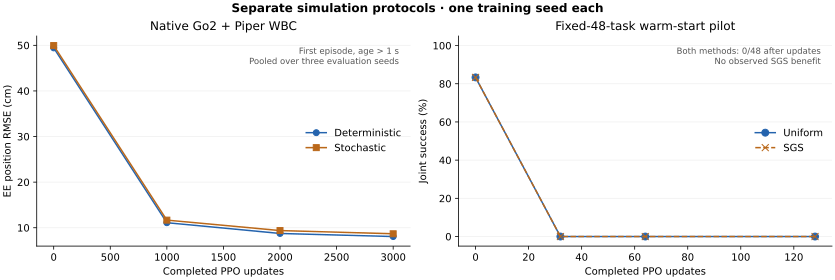

# Legged Robot Learning

**Reinforcement Learning for Legged Locomotion and Whole-Body Control**

An independent research collection by [chao142857](https://github.com/chao142857), covering quadruped locomotion, mobile manipulation, adaptive task sampling, and PPO update diagnostics. The research implementations, experiment design, and analyses are organized here with explicit upstream attribution and evidence boundaries.

**All reported robot experiments are simulation results. This release establishes no real-robot validation and no stable SGS advantage over Uniform sampling.**

## Research Overview

The work studies how task distributions, reward design, reset semantics, and policy updates affect learned control. It includes successful learning runs, failed baselines, controlled interventions, and tools for examining why an apparently reasonable PPO update can behave poorly.

The projects retain their original framework generations and experimental identities. A fixed-task warm-start pilot, a native-distribution scratch baseline, and a constrained recipe are different experiments; their scores are not combined into a single leaderboard.

## Projects

| Project | Research content | Current evidence |
|---|---|---|
| [Z1 Locomotion](projects/z1_locomotion/README.md) | Training configurations, stairs curriculum, contact-aware rewards, standing sampling, height-reward A/B study, evaluation | Simulated traversal and contact diagnostics; strict downstairs safety remains unresolved |
| [Go2 + Piper WBC](projects/go2_piper_wbc/README.md) | Native WBC baseline, fixed task suite, T1 scratch study, Recipe v1 and A+ preparation | Native learning demonstrated; formal Recipe v1 T1 gate remains false |
| [SGS](projects/sgs/README.md) | Success Guided Sampling implementation, reset/feedback lifecycle, fixed evaluation isolation, historical pilot, factorial preparation | Tested sampler contracts; historical pilot gives no joint-success benefit |
| [PPO Gradient Lab](projects/ppo_gradient_lab/README.md) | Frozen-policy gradients, component value probes, native GAE, KL, clipping, Adam and held-out surrogate diagnostics | CPU diagnostic evidence; no demonstrated control-performance improvement |

## Methods

- **Locomotion and WBC:** PPO through the native RSL-RL/Isaac training stacks; independent task adapters and explicit reset, action, contact, and observation checks.
- **Controlled interventions:** matched initialization and budgets where the protocol supports them; reward-height intervention, command-sampling changes, and native-distribution references. Differences in task, reset, action dimension, or controller priors remain visible.
- **Adaptive sampling:** a local implementation of SGS from [Zhang et al., *A Balanced Data Diet*](https://arxiv.org/abs/2610.12465v1), with episode ownership, censored-outcome handling, isolated RNG, state validation, and evaluation separation. The unvisited-task prior of 0.5 is a documented local choice.
- **Update analysis:** native total-advantage calibration and isolated PPO/Adam steps, with frozen held-out surrogate measurements. Component probes are diagnostic approximations, not an exact decomposition of native PPO.

## Experimental Results

| Experiment | Selected observation | Interpretation |
|---|---|---|
| Z1, October 16 height/contact study | Downstairs strict safety: **0/48** for the original policy and both continuations; calf-contact fraction A 10.17%, B1 6.88% | Lower contact exposure did not establish safe downstairs control; early foot loading also increased |
| Go2 + Piper, native WBC CP3000 | Deterministic survival **768/768**; XY RMSE **0.1189 m/s**, EE position RMSE **8.07 cm** | Learned simulated locomotion and pose tracking; not high-precision or complete safety acceptance |
| Recipe v1 CP1200, formal T1 | Completion **192/192**, EE RMSE **2.42 cm**, original full-episode strict safety **15/192** | Different task distribution from native WBC; turning, startup overspeed and dynamic X tracking remain limitations |
| SGS fixed-48-task pilot | Both methods: **40/48** joint success at initialization, **0/48** after 32, 64 and 128 updates | No observed SGS joint-success gain; degenerate success feedback limits the comparison |
| PPO microscope | 120 distinct isolated candidates; smaller LR reduced held-out clipped-surrogate deviation in the main window | Surrogate evidence, not improved robot return or a proven cause of historical training failure |

Native WBC errors use valid first-episode samples after the first second. Recipe values use equal averaging over three evaluation seeds. These are different aggregation rules and protocols. Each cited learning study has one training seed; evaluation seeds do not establish training-seed reproducibility. Full definitions and result links are in [RESULTS.md](RESULTS.md).



## Reproducibility

Start with the [environment and entry-point guide](docs/REPRODUCIBILITY.md). CPU checks use synthetic inputs and published numerical summaries:

```bash
python tools/audit_publication.py
python tools/cpu_smoke.py
```

`cpu_smoke.py --require-ml` requires the optional Torch/RSL dependencies. Missing dependencies and the real-checkpoint parity test are reported explicitly. Simulator-free `--check` entry points are provided for both robot projects. No training starts during these checks.

Full simulation reproduction requires independently obtained upstream software, compatible Linux/GPU environments, and authorized robot assets. Model geometry, pretrained policies, checkpoints, and raw rollouts are excluded. Historical continuation studies additionally require the original source-bound inputs; public summaries cannot reconstruct them.

The [source map](SOURCE_MAP.md), [publication audit](PUBLICATION_AUDIT.md), [per-file provenance](provenance/files.json), and [validation report](VALIDATION.md) separate historical observations from checks executed for this release. This repository starts with new Git history; it does not expose the private source repository.

## Limitations

- No hardware validation, sim-to-real guarantee, or continuous-time safety claim.
- Z1 actuator parameters are provisional simulation settings. Team-supplied model assets and their visualizations are not redistributed.
- The native WBC baseline and Recipe v1 retain distinct task domains and safety statistics; their error values are not a matched algorithm comparison.
- SGS has no demonstrated stable gain here. B1/B2/B3 are preparation candidates, not trained or physically admitted baselines.
- Recipe A+ has **0 additional completed updates** in the inspected snapshot; its planned continuation is not a result.
- CPU smoke tests cover imports, numerical contracts, and entry-point checks. Isaac/PhysX/Newton execution and long GPU training were not rerun for publication.
- Selected numerical summaries are available; withheld raw trajectories, weights, and geometry limit independent end-to-end recomputation.

## Acknowledgements

The experiments build on [IIT DLS Lab's basic-locomotion-isaaclab](https://github.com/iit-DLSLab/basic-locomotion-isaaclab), [LeggedManip_Lab](https://github.com/zzzJie-Robot/LeggedManip_Lab), [Isaac Lab](https://github.com/isaac-sim/IsaacLab), and [RSL-RL](https://github.com/leggedrobotics/rsl_rl). SGS is credited to its original authors. The collaborating team supplied the Z1 robot model; model ownership is distinct from the independent algorithm/training work presented here.

Original contributions use Apache-2.0. Applicable upstream notices are retained in [NOTICE](NOTICE), [LICENSES](LICENSES/), and [THIRD_PARTY.md](THIRD_PARTY.md). Source-code licenses do not confer redistribution rights to excluded assets or policies.
