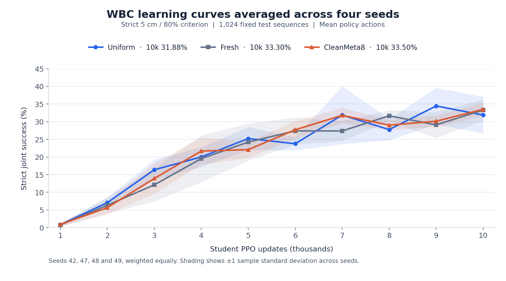

# nSGS

**面向全身控制的神经成功引导采样**

[English](README.md) · 简体中文

nSGS 研究如何根据机器人策略的学习状态调整训练任务分布。实验使用 Go2 四足机器人与 Piper 机械臂，在仿真中通过 PPO 学习移动与末端跟踪，动作维度为 18。

## CleanMeta8 结果

| 采样方法 | CP10000 严格联合成功率 |
| --- | ---: |
| Uniform | 31.88% |
| Fresh Teacher | 33.30% |
| CleanMeta8 | 33.50% |

Student seeds 42、47、48、49 等权平均；固定 1,024 条测试序列，阴影为种子间一个样本标准差。按表中显示值相减，CleanMeta8 相对 Uniform 为 +1.62 个百分点（未舍入差值为 +1.6113）。四个 Student 共享一个元训练 Teacher，结果仍属初步观察，不代表多次独立 Teacher 训练的稳定优势。[数值数据](results/cleanmeta8/curve_data.json)

CleanMeta8 从相同 Student 起点进行 Uniform、正扰动、负扰动三个 100-update PPO 分叉，以后续控制表现反馈更新 Teacher。修正版独立恢复 Adam 状态；存在 snapshot aliasing 的 OldMeta8/16 保留为历史版本。

## 方法演进与 CL1

研究按 SGS evaluation → Clustering → OldMeta → CleanMeta → CL1 Base/Recovery 整理。CL1 使用 GRU recurrent Teacher 与 outer PPO，与 CleanMeta8 算法及权重分开。

截至 2026-11-12，Base 源 Student seed43/44 的 10k 严格成功率为 29.20%／30.08%；Recovery V2 已完成新增 2k Student 更新。未参与 Teacher 训练的 Student seed70158 三臂 10k 已核实完成：Uniform 34.57%、冻结 Base 31.05%、冻结 Recovery V2 35.55%。这是单个未见 Student 的描述性比较，不与 CleanMeta8 四种子均值混合，也不能单独归因于退化专项机制。seed70159 仍在进行。

[实验历史](docs/experiments.md) · [复现指南与完整成功定义](docs/reproduction.md) · [迁移映射](docs/migration.md)

## 复现、引用与许可

实验使用 Isaac Lab、LeggedManip_Lab、RSL-RL，4,096 个并行环境，每轮 rollout 24 步。仓库保留共享组件、真实运行时代码、配置、数值证据与 CPU 回归测试；仿真复现还需要外部环境、序列池及授权机器人资产。

研究基于 [SGS](https://arxiv.org/abs/2610.12465v1)、[LeggedManip_Lab](https://github.com/zzzJie-Robot/LeggedManip_Lab)、[Isaac Lab](https://github.com/isaac-sim/IsaacLab) 与 [RSL-RL](https://github.com/leggedrobotics/rsl_rl)。全部结果来自仿真。原创代码采用 [Apache-2.0](LICENSE)，上游代码与资产遵循各自许可，见 [第三方声明](THIRD_PARTY.md)。
