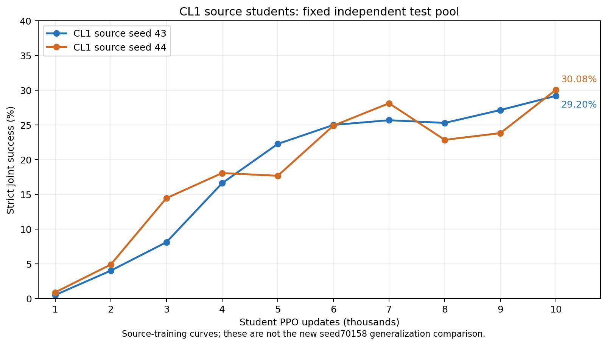

# CL1 当前结果与修复记录

本报告区分已完成的源训练、旧 Recovery 数据收集、尚未完成的新学生泛化对照。旧结果和 checkpoint 均保留；没有把重算结果写回旧实验。

## 已有结果

| 项目 | 更新数 | 严格联合成功率 | 连续联合得分 | EE位置RMSE |
|---|---:|---:|---:|---:|
| CL1源学生 seed43 | 10000 | 29.20% | 0.5968 | 5.399 cm |
| CL1源学生 seed44 | 10000 | 30.08% | 0.6039 | 5.355 cm |
| 新学生 seed70158 Uniform | 1000评测点 | 0.78% | 0.1072 | 10.841 cm |

源学生43/44各完成10k，共20k。它们参与了Teacher学习，不能当作未见学生泛化结果，也不能与新seed的1k成绩直接比较。新Uniform暂停时实际执行到1448；最后完整、可配对恢复的边界为1400。冻结Base、冻结Recovery尚未开始正式新学生训练。

### 每千次严格成功率

| PPO更新 | seed43 | seed44 |
|---:|---:|---:|
| 1000 | 0.49% | 0.88% |
| 2000 | 4.00% | 4.88% |
| 3000 | 8.11% | 14.45% |
| 4000 | 16.60% | 18.07% |
| 5000 | 22.27% | 17.68% |
| 6000 | 25.00% | 24.90% |
| 7000 | 25.68% | 28.12% |
| 8000 | 25.29% | 22.85% |
| 9000 | 27.15% | 23.83% |
| 10000 | 29.20% | 30.08% |

### 旧Recovery的2k数据收集

原计划上限4k，但只找到一批满足原筛选规则的平衡片段，实际为4×500=2k、20个Teacher宏转移、一次外层更新。下列续训采集期间Teacher仍为冻结Base，**不能把这些增益说成新Recovery策略的效果**。

| 起点 | 原标签 | 500更新前J | 500更新后J | 变化（百分点） |
|---|---|---:|---:|---:|
| recovery-b0-f0-seed43-from06900 | 退化 | 0.5116 | 0.5409 | +2.93 |
| recovery-b0-f1-seed43-from06400 | 正常 | 0.5434 | 0.5217 | -2.17 |
| recovery-b0-f2-seed44-from07300 | 退化 | 0.5139 | 0.5477 | +3.38 |
| recovery-b0-f3-seed44-from06800 | 原正常，现标为含糊 | 0.5580 | 0.5735 | +1.56 |

## 已确认问题与修复

1. **恢复状态没有原子配对。** 旧控制器只恢复Student，并可能沿用更靠后的Teacher current.pt；内部100更新checkpoint还包含已选择、尚未执行的下一宏动作。现在将Student checkpoint与同一边界的不可变Teacher快照绑定，校验seed、训练臂、权重、反馈更新号、pending动作和哈希；有pending时原样沿用，不重复抽取或重复追加记忆。未完成/失败尝试保留，故障停止，不强删活跃容器盲目重跑。
2. **正常标签不够严格。** 原实现使用“未同时满足两个退化条件”作为正常，包含只在一项明显退化的样本。这是我上一轮筛选实现的不足，不是Adam权重污染。V2保留原退化阈值：退化为ΔJ≤−0.03且ΔEE≥0.003m；正常要求ΔJ>−0.03且ΔEE<0.003m；只触发一项的片段单独标为含糊并排除。
3. **冻结动作记录不清晰。** 新版确定性动作log_prob记为null，并明确禁止当作on-policy Teacher训练样本；不再先抽高斯再丢弃。Uniform的执行偏好与概率显式为零向量及1/32768，不将未执行的Base建议误当作采样干预。冻结推理每次校验权重、Adam和Teacher RNG不变。原始历史证据不重写。
4. **统计与协议元数据。** 新泛化协议明确seed70158、三臂各10k、冻结均值策略及V2来源。只认10k终点评测；逻辑学习进度与实际执行、重试、丢弃和smoke成本分开。三组均采用500、1000、1400、1500、之后每500的恢复边界，避免只有Uniform多一次恢复。

## 正常片段的修正

| seed | 类别 | V1起点 | V2起点 | V2窗口ΔJ | V2窗口ΔEE |
|---:|---|---:|---:|---:|---:|
| 43 | degradation | 6900 | 6900 | -6.398百分点 | +3.640mm |
| 43 | normal | 6400 | 6400 | +0.574百分点 | +0.112mm |
| 44 | degradation | 7300 | 7300 | -4.506百分点 | +3.506mm |
| 44 | normal | 6800 | 7800 | +0.749百分点 | -0.283mm |

新正常片段按原随机种子20261109、相近阶段和非重叠规则选择，只使用起点及此前的源开发记录，没有用续训后成绩或正式测试选起点。V2从原Base网络及Adam重新出发，重采四条真实500-update片段；不会继承旧Recovery再多训。旧Recovery继续保留为V1，不伪改标签或权重。

## 验证与后续执行

- 新增7项配对/筛选测试和2项冻结RPC测试已通过；另外重跑原有9项核心及12项Adam回归。
- 真实GPU恢复smoke已通过：1400→1410共10次PPO，保留pending教学动作，未重复抽取，Teacher权重/Adam/RNG未变化，Student的可保存状态和下一4096次抽样通过恢复校验。PhysX隐藏接触缓存仍不能承诺逐位恢复。
- 泛化三臂先保持暂停；目前运行纠正后的Recovery 2k。新Teacher验收并锁定后自动续接Uniform（1400起）→冻结Base→冻结RecoveryV2，各到10k。
- 没有因采样偏好小而调学习率、探索标准差、TV半径、奖励或PPO配置；未恢复TR0、Meta24。
- 原Uniform从1400恢复，已执行但未形成完整恢复边界的48次更新单列成本；新增10次smoke也不计入正式10k。V1与V2的Recovery各2k，合计科研支出4k，但V2本身只训练2k。

## 仍需如实观察的研究结果

旧Uniform臂中的旁路Base建议分布TV仅约0.055%–0.231%，这只是未执行的建议，且历史包含旧旁路动作，不可当作Base实际运行曲线。均值偏好可能很弱，这是待验证的算法表现，不能用改参数或扩大TV冒充工程修复。后续以冻结Base/Recovery真正执行的概率、曝光和独立测试曲线判断效果。
一条新Student seed只能提供描述性比较。RecoveryV2与Base同时差在新增2k经验及情境组成，没有等预算普通续学组，因此即使提高，也不能单独归因为“退化专项机制”。

## 文件与运行位置

- 原CL1及V1：`/data/go2_piper_nsgs_cl1_20261109/`
- 原新seed尝试，已暂停保存：`/data/go2_piper_nsgs_cl1_gen_seed70158_20261110/`
- 修复及RecoveryV2：`/data/go2_piper_cl1_repair_20261110/`
- 修复后泛化续跑：`/data/go2_piper_nsgs_cl1_gen_seed70158_fixed_20261110/`
- 持久队列：`nsgs-cl1-repair`；执行日志：修复目录的`master.log`。
- 本目录`evidence/`保留修复前结果、片段计划、配对和真实smoke验收。
