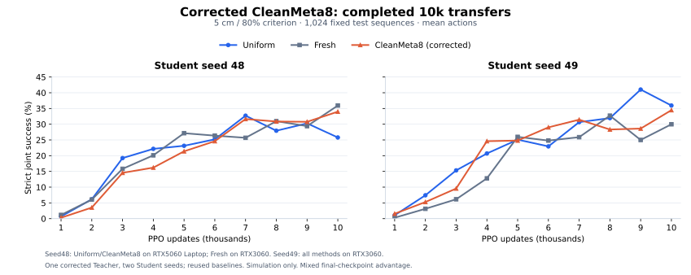

# CleanMeta8 — corrected V0.2 reproduction

**Status: completed.** Both Student transfers completed on 9 November 2026; this public result snapshot was verified on **10 November 2026**. This page supersedes the 6 November progress notice as the public entry point for the corrected experiment. It does not overwrite historical implementation artifacts.

## What was corrected

The audited V0.2 backtracking implementation repeatedly loaded the same CPU Adam snapshot. Mutable optimizer tensors could share storage with that snapshot, allowing a trial `optimizer.step()` to change the state meant to restore the next trial. Restoring network parameters alone did not restore optimizer history. Historical Meta8 and both Meta16 lineages are affected; this does not establish that the bug caused any particular success-rate change.

The correction deep-copies optimizer state on **each load**, including backtracking, rejection rollback and checkpoint restoration. Accepted updates must match one optimizer-state step from the common pre-trial state; rejected trials must not accumulate moments. The independent [audit, tests and physical smoke](https://github.com/chao142857/legged-robot-learning/blob/c43b36ea4cb3dbdaa3d0f72730c349188a6d5130/projects/sgs/teacher_adam_audit_20261109/REPORT.md) document the implementation fix. The runtime file hash is recorded in [the acceptance summary](evidence/adam_acceptance_summary.json).

For this new run, all eight accepted updates passed the full trace checks and Adam advanced **0 → 8**, rather than the historical Meta8 final step 15. The complete Teacher state installed for seed 49 matches the seed 48 source state; checkpoint container hashes differ because of serialization/provenance metadata. Old checkpoints were not relabeled, their step counters were not reset, and old outcomes were not replayed as new on-policy feedback.

## Executed experiment

- **Teacher:** restart from the original Fresh full state; source Student seeds 43/44 at 1k, 3k, 6k and 9k, ordered by stage then seed. From each restored state, run Uniform/q+/q− for exactly 100 new PPO updates and evaluate on the fixed development pool. Eight points × three arms × 100 = **2,400 new Student PPO updates / 235,929,600 training transitions**.
- **Algorithm:** original V0.2 neural sampler, same network and hyperparameters, 20% Uniform mixture; no new sampling-TV constraint. Teacher updates use new paired branch outcomes. The development metric is continuous joint compliance, not formal-test strict success.
- **Students:** one frozen corrected Teacher, seeds 48 and 49, each trained from scratch to 10k with 4,096 environments and rollout 24. Each contributes **983,040,000 training transitions**. Native reward, observations, 18D actions, termination, randomization, Student network and PPO configuration are retained.
- **Baselines:** reuse the existing same-seed Uniform/Fresh runs after configuration, initialization and evaluation-identity checks. No duplicate baseline training was launched. OldMeta8/16 are separate legacy implementation observations, excluded from the current three-method plot.
- **Selection:** final CP10000 is the reported endpoint; intermediate checkpoints are retained. Source branches are evaluated after the fixed 100-update continuation, without choosing the best intermediate model.

## Final strict joint success

| Student seed | Uniform | Fresh | CleanMeta8 | vs Uniform | vs Fresh |
|---:|---:|---:|---:|---:|---:|
| 48 | 25.78% | 35.94% | **33.98%** | +8.20 pp | -1.95 pp |
| 49 | 35.94% | 29.98% | **34.47%** | -1.46 pp | +4.49 pp |

At seed 48, CleanMeta8 is +8.20pp against Uniform and −1.95pp against Fresh. At seed 49 it is −1.46pp against Uniform and +4.49pp against Fresh. **These two transfers do not establish a consistent advantage over either baseline.** They are two Student seeds sharing one Teacher training run, not two independent meta-training replications.

| Student seed | CleanMeta8 wall time | Continuous joint score | EE position RMSE | Native failure rate |
|---:|---:|---:|---:|---:|
|48|6h52m|62.80%|5.187cm|0.195%|
|49|6h02m|61.40%|5.262cm|0.098%|

Wall time is the recorded Student process duration, including waits for periodic evaluations; it excludes the separate Teacher meta-training cost. New training in this reproduction totals 22,400 Student PPO updates / 2,202,009,600 transitions, excluding evaluation transitions. Baseline training cost is not counted as newly executed work.

## Full checkpoint curves

### Student seed 48

| PPO updates | Uniform | Fresh | CleanMeta8 |
|---:|---:|---:|---:|
| 1000 | 0.68% | 1.17% | 0.29% |
| 2000 | 6.15% | 6.05% | 3.52% |
| 3000 | 19.24% | 15.82% | 14.55% |
| 4000 | 22.17% | 20.12% | 16.21% |
| 5000 | 23.14% | 27.15% | 21.39% |
| 6000 | 25.20% | 26.37% | 24.61% |
| 7000 | 32.71% | 25.68% | 31.64% |
| 8000 | 27.93% | 30.96% | 30.86% |
| 9000 | 30.27% | 29.39% | 30.76% |
| 10000 | 25.78% | 35.94% | 33.98% |

### Student seed 49

| PPO updates | Uniform | Fresh | CleanMeta8 |
|---:|---:|---:|---:|
| 1000 | 1.07% | 0.29% | 1.56% |
| 2000 | 7.42% | 3.13% | 5.27% |
| 3000 | 15.33% | 6.15% | 9.57% |
| 4000 | 20.70% | 12.79% | 24.61% |
| 5000 | 25.10% | 25.98% | 24.80% |
| 6000 | 22.95% | 24.80% | 29.00% |
| 7000 | 30.66% | 25.88% | 31.45% |
| 8000 | 31.93% | 32.71% | 28.32% |
| 9000 | 41.02% | 25.00% | 28.61% |
| 10000 | 35.94% | 29.98% | 34.47% |

The plotted baselines were reused, not rerun. **Seed 48:** Uniform/CleanMeta8 use RTX 5060 Laptop; Fresh uses RTX 3060. **Seed 49:** all three methods use RTX 3060. Equal initial network weights do not pair the complete future training trajectories, and PhysX hidden contact caches are not serialized.

## Strict metric and evaluation separation

Every formal point uses the same independent 1,024-sequence test pool, fixed evaluation seed 922042 and mean actions. Tolerances are XY velocity 0.2 m/s, yaw rate 0.3 rad/s, EE position 0.05 m and EE orientation 15 degrees. Both command ages must reach 2 seconds before scoring. A successful episode has at least 100 scored steps, no native failure, at least 80% simultaneous four-tolerance compliance, and scored RMSE within all four tolerances. Timeout alone is not success.

Continuous joint score averages per-episode simultaneous-compliance fractions, with native failures or fewer than 100 scored steps assigned zero. It is not strict success, nor the longest uninterrupted good-time duration. Formal test results do not update training sampling histories or Teacher parameters. The separate development pool has 256 sequences × 2 fixed resets and supplies Teacher branch feedback. Evaluation transitions are additional to the training budgets above.

## Evidence and source map

- [All 60 formal points, physical metrics, initialization and checkpoint/evaluation hashes](evidence/completed_curves.json).
- [Eight full-trace Adam acceptance summaries and cross-host Teacher state identity](evidence/adam_acceptance_summary.json).
- [Executed reproduction, revision 03 queue and same-seed baseline catalog](https://github.com/chao142857/legged-robot-learning/tree/b1b5cd5b092967678b9b5f315676da6f442bc9f4/projects/sgs/cleanmeta8_20261109); the historical launch plan is not the final executed schedule.
- [Canonical corrected Teacher, regression tests and retrospective audit](https://github.com/chao142857/legged-robot-learning/tree/c43b36ea4cb3dbdaa3d0f72730c349188a6d5130/projects/sgs/teacher_adam_audit_20261109). The local historical-update reanalysis is diagnostic evidence, not a replacement for these new physical branches.
- [Original 6 November snapshot](https://github.com/chao142857/legged-robot-learning/tree/da583b33b10351a8e5c9f19e61b75ba929ea026d/projects/sgs/nsgs_v02_20261106) remains a historical record with the old implementation identity. [CL1](https://github.com/chao142857/legged-robot-learning/tree/ab4532ea1af7ab7751136e95dd4187d386457ee5/projects/sgs/nsgs_cl1_20261109) is a separate follow-up protocol and is not included in this comparison.

Only lightweight numeric summaries, hashes and an SVG curve are published here. Full checkpoints, per-step physical trajectories, model geometry, videos and raw feedback streams remain on the execution hosts. These summaries do not provide independent end-to-end physical recomputation or real-robot validation. No statistical-significance claim is made, and the cross-host Teacher-feedback noise prevents attributing all performance differences solely to the optimizer fix.

To regenerate the SVG from the published numbers, run `python tools/plot_cleanmeta8.py` from the repository root using the optional analysis dependencies.
