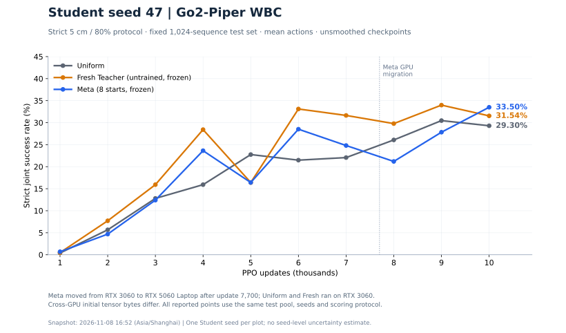
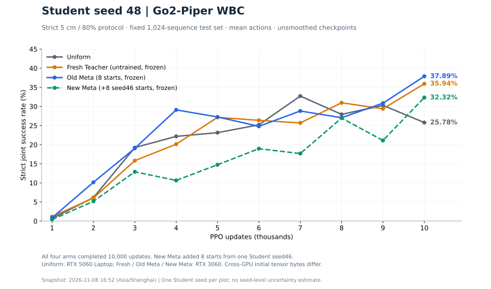

# nSGS V0.2：两轮完成结果与同起点续学实验

seed47 的三组和 seed48 的四组均已完成从零 10k。这里保留七条每千更新严格评测曲线、连续物理指标、完成收据及轻量实现。此前的 E1–E3、六组15k及11月6日归档不作修改。

## 已完成结果

严格成功采用固定1024条独立测试序列、均值动作、原5cm／80%四项联合判据。连续联合得分是有效窗口中四项同时达标的比例，原生失败或无足够有效窗口记0，保留全部回合分母。

| Student seed | 方法 | 10k严格联合成功率 | 10k连续联合得分 | EE位置RMSE（cm） | 1k–10k成功率曲线均值面积 |
|---|---|---:|---:|---:|---:|
| 47 | Uniform | 29.30% | 60.19% | 5.347 | 19.12% |
| 47 | Fresh（冻结） | 31.54% | 58.97% | 5.431 | 23.67% |
| 47 | 旧 Meta（冻结） | 33.50% | 61.04% | 5.219 | 19.62% |
| 48 | Uniform | 25.78% | 56.20% | 5.596 | 22.23% |
| 48 | Fresh（冻结） | 35.94% | 62.91% | 5.252 | 22.23% |
| 48 | 旧 Meta（冻结） | 37.89% | 63.75% | 5.180 | 24.05% |
| 48 | 单seed46续学 Meta（冻结） | 32.32% | 61.88% | 5.205 | 16.05% |

面积按十个已测checkpoint线性连接、对1k–10k区间梯形积分后除以9000，不补0k点。完整70个评测点及原文件路径/SHA256见 [completed_curves.json](evidence/completed_curves.json)。

旧Meta在两个seed的10k终点均比Fresh高1.953个百分点，但seed47整条曲线的面积仍低于Fresh。不能只凭终点宣布稳定改进。seed48单seed46续学Meta的10k结果低于旧Meta5.566个百分点、低于Fresh3.613个百分点，增加经验未在这轮带来收益。

## 新旧Meta分别学过什么

- 旧Meta：seed43、44各取1k/3k/6k/9k，共8个学生起点；每起点Uniform/q+/q−各100 PPO更新，8次Teacher更新。
- 此前单seed46续学Meta：继承旧Meta网络、Adam和私有RNG，新增seed46的100/500/1000/2000/3000/3500/4500/5300八个起点，新增2400次真实PPO更新。7次非零收益差、1次零差；零差跳过动量更新。Teacher总计16次反馈周期。
- Fresh：同架构、未做反事实学习的初始Teacher。迁移阶段Fresh、旧Meta、续学Meta均冻结参数，每100次学生更新依学生真实反馈重新输出概率。冻结不表示分布固定。

单seed46续学同时改变了起点种子多样性与训练阶段，现有结果不能把回退单独归因于“经验更多”或“只有一个seed”。历史Teacher更新、来源和网络变化校验见 [single_seed46_continuation](evidence/single_seed46_continuation)。

## 本轮：从旧Meta重新做匹配来源的续学

按用户2026-11-08授权执行；不从此前单seed46续学Meta继续。

1. 精确保留旧Meta8次更新后的网络、Adam、私有RNG，文件SHA256：`8929d0a13c4aaa7b98c70acf584d04390711bbc9ea6df8b61f3bcb556cdbd3b9`。
2. 重新使用原seed43、44各1k/3k/6k/9k的可恢复状态。按阶段、再seed顺序，共8次新决策。每起点重新采样对称扰动，真实执行Uniform/q+/q−各100更新，共2400次新增PPO更新。旧分叉收益不作为新on-policy梯度重放。
3. 沿用8维Teacher、Gaussian σ=0.5、20% Uniform混合、原Adam/KL保护。Teacher版本8–15，完成后冻结。
4. Student seed48从零训练10000次；4096env、rollout24、原PPO/奖励/观测/18D动作/域随机化；每100开发评测、每1000正式测试。开发池256×2，正式测试1024；正式测试不进入教师学习。
5. 两段GPU smoke共4次更新，仅验证恢复与工程链路，不进入Teacher经验或正式Student。低收益不构成停止条件。

这增加的是同一8个历史学生起点上的新采样干预与真实后续收益，不是再增加8个独立学生起点。seed48及原正式结果已被查看，本轮属于后续探索验证。

### 执行位置与恢复

- 主机：ubuntu-robot，RTX5060 Laptop 8GB。
- 逻辑根：`/home/alex/dog/go2_piper_nsgs_v02_matched_seed48_20261108/`。
- 大输出：`/media/alex/Sharedata/go2_piper_nsgs_v02_matched_seed48_20261108/`，runs/experience/starts以稳定链接指向该分区。
- 训练tmux计划名：`nsgs-matched-seed48`；状态见该根目录`STATUS.json`，具体启动收据将在实际启动后追加。
- 原YangLab8个prepared状态和原始checkpoint均保留。只省略两个运行不读取的重复provenance字段，所有actor/critic/optimizer/adapter/environment/RNG/context字段逐项哈希不变。映射和逐文件哈希见 [sources.json](matched/sources.json)、[导出清单](matched/source_export_manifest.json)。
- 单个获准SSH传输包428464362字节，SHA256 `9fd501b688c052cbf54c71608dc5aa9ee65e09099387a282c768c673c0e8d267`。分起点只在四份文件完整且SHA通过后释放给训练，全包还会独立校验。
- 新Student必须与已有同机seed48 Uniform初始actor/critic及空optimizer记录完全一致。显式物理状态和RNG可核对，PhysX隐藏solver缓存不能保证逐位恢复。

本次提交时45项CPU工程测试已通过；状态包导入及GPU smoke/训练启动收据以之后的实际记录为准，不将准备完成写成训练完成。

## 比较限制

seed47旧Meta在7700后从3060迁至5060，续训收据中的wall_seconds只代表恢复段；不能当整条10k耗时。seed48 Uniform在5060，Fresh/旧Meta/单seed46续学Meta在3060。本轮匹配来源Meta在5060：可与已有同机Uniform核对初始化和评测，但与旧Meta的比较仍包含GPU差异。相同seed不保证不同采样方法的随机轨迹完全配对，跨GPU评测初始张量字节也不同。曲线均为单学生seed，不宣称显著性。

## 源码与复核

为减少重复推送，`executed_yanglab_seed48/`和`matched/`仅保存相对 [11月6日不可变归档](../nsgs_v02_20261106/)有变化的代码/测试，以及各自控制器、协议、完整文件哈希清单。重建时先复制该归档code/tests，再覆盖对应目录；不能混用两个overlay。matched中的prepare_continual.py为兼容文件，生效入口是prepare_matched.py与controller.py。

原生代码为LeggedManip_Lab `4e12109d1eccb1d9da2e4a35f189fabea3f13677`，Isaac Lab `b0542fe2d45bf91c4e1d9ef6952b9c709c80b4e8`。实际运行依赖服务器缓存的Isaac资产、原生仓库、环境和完整状态，本归档不是仅clone即可运行的独立仿真包。未上传模型、视频、原始逐步日志或完整经验张量；摘要保留其执行位置与哈希。

CPU测试收据在[evidence](evidence/)。重建后运行`python -m unittest discover -s tests -v`，不启动仿真。`PACKAGE_MANIFEST.json`及`verify_archive.py`用于本归档完整性检查。
